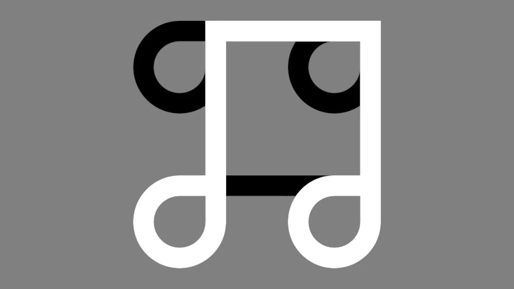
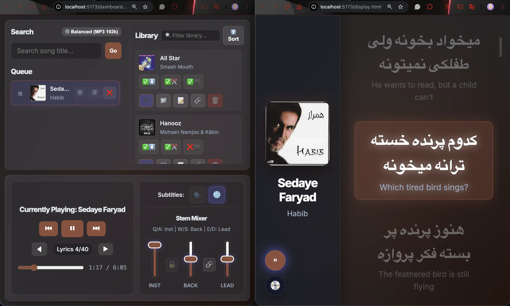
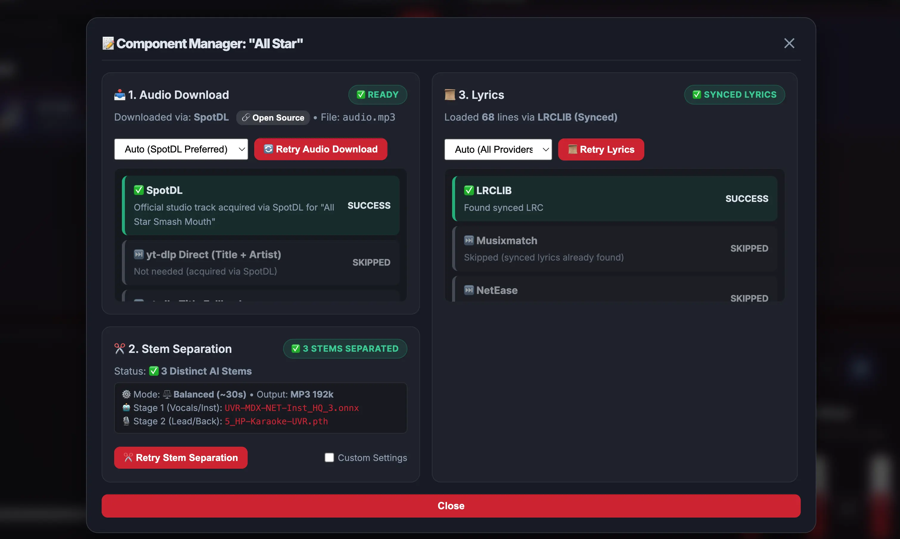

# Ctrl+Alt+Lyrics



A local all-in-one full-stack Karaoke Player and Lyrics Studio designed for downloading, splitting audio stems, synchronizing lyrics, and playing high-quality karaoke tracks in real time.
> Vibe-coded with Google Antigravity IDE & Gemini

---

## ⚡ Quick Setup

### Prerequisites
- **Node.js**: v18+ 
- **Python**: v3.10+ (v3.12 recommended)
- **FFmpeg**: Required for audio stem splitting and processing

### 1. Install Dependencies
```bash
# Install root & frontend Node dependencies
npm install && cd frontend && npm install && cd ..

# Setup Python virtual environment & dependencies
python3 -m venv .venv
source .venv/bin/activate
pip install -r requirements.txt
```

### 2. Start the Application
Run in two separate terminals:

```bash
# Terminal 1: Backend Server (starts on http://localhost:3000)
npm start

# Terminal 2: Frontend Client (starts on http://localhost:5173)
npm run dev
```

Open **`http://localhost:5173`** in your browser to launch the main hub, Dashboard, or Display view.

---

## 🚀 Key Features

- **AI Stem Separation**: Automatically downloads tracks and splits audio into distinct stems (**Instrumental**, **Lead Vocals**, **Backing Vocals**) via Demucs.
- **Stem Mixer**: Real-time volume sliders, mute toggles, and keyboard shortcuts with seamless master handoff between views.
- **Synchronized Lyrics**: Auto-fetches timestamped LRC lyrics with an integrated interactive sync editor.
- **Pronunciation & Romanization**: Auto-generates Romanized pronunciations for non-English lyrics (Japanese via `pykakasi`; Persian, Korean, Cyrillic, Greek, etc. via `unidecode`).
- **Dual Synced Views**:
  - **Dashboard**: Queue management, song library, stem mixer, and lyrics synchronization.
  - **Display View**: Clean stage/party screen with smooth 60fps lyric animations, visualizer canvas, and dynamic album-cover color palettes.
- **Real-Time State Sync**: WebSocket-driven bidirectional synchronization across all tabs via Socket.IO.

---

## 🛠️ Architecture & Tech Stack

### Frontend
- **React 19 & Vite**: Component-driven architecture with dedicated multi-page entry points (`DashboardApp.jsx`, `DisplayApp.jsx`).
- **Zustand**: Fast, lightweight reactive state management (`usePlaybackStore`, `useLibraryStore`, `useQueueStore`, `useSettingsStore`).
- **Web Audio API**: Multi-node stem player (`audioPlayer.js`) with sample-accurate offsets, stem gain mixing, and master handoff.
- **Glassmorphism UI**: Dynamic color extraction from album covers, responsive split-pane resizers, and Lucide icons.

### Backend
- **Node.js & Express**: RESTful endpoints (`backend/src/api.js`) for library management, downloads, and audio streaming.
- **Socket.IO**: Real-time event pub/sub ensuring single-source-of-truth playback state between clients.
- **SQLite3**: Lightweight local database for library metadata, queue items, and cache history.

### Audio & Lyrics Processing (Python)
- **`spotdl`**: Track downloader and metadata extraction.
- **`audio-separator`**: Demucs-based neural audio stem splitting.
- **`pykakasi` & `unidecode`**: Multi-language phonetics, transliteration, and Romanization.

---

## 📁 Project Structure

```
CtrlAltLyrics/
├── .venv/              # Python virtual environment (AI stem separation & lyrics)
├── backend/
│   ├── data/           # SQLite database & song metadata cache
│   ├── downloads/      # Downloaded audio tracks & separated stems
│   └── src/            # Express routes, Python separation & lyrics scripts
├── frontend/
│   ├── public/         # Static assets and brand logos
│   ├── src/
│   │   ├── components/ # Dashboard, Display, & Modal UI components
│   │   ├── hooks/      # Custom React hooks (resizers, shortcuts)
│   │   ├── services/   # Web Audio player & Socket.IO client
│   │   ├── stores/     # Zustand stores (playback, queue, library)
│   │   ├── DashboardApp.jsx
│   │   └── DisplayApp.jsx
│   ├── index.html      # Hub page
│   ├── dashboard.html  # Dashboard entrypoint
│   ├── display.html    # Display entrypoint
│   └── vite.config.js  # Multi-page Vite configuration
├── media/              # Demo screenshots & previews
├── server.js           # Main Express & Socket.IO server
├── package.json        # Project scripts & Node dependencies
└── requirements.txt    # Python package dependencies
```

---

## 📸 Screenshots


*Display view (left) and Dashboard controls (right) running in real-time sync.*


*Interactive Lyrics & Sync Editor modal.*

---

## 📄 License

ISC License
